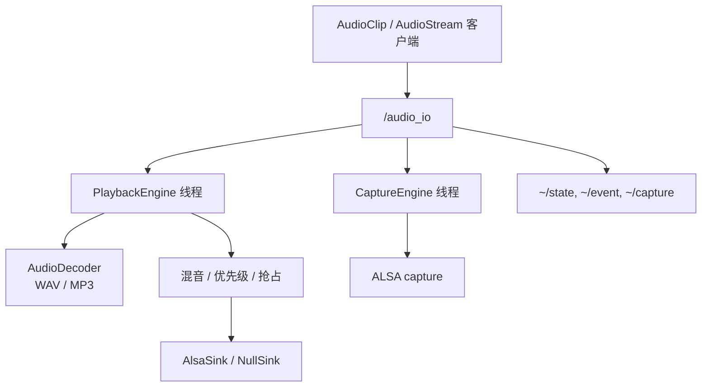

# audio_io 架构与实现

> 功能包：`audio_io`（独立 Git 仓库）。
> 接口包：`audio_io_interface`。
> 状态：已实现 v0.1。本文只描述 `audio_io` 自身。

---

## 0. 一句话结论

`audio_io` 是一个通用 ROS 2 音频 I/O 功能包：由一个节点独占播放/采集设备，其他节点只发送 `AudioClip` 或 `AudioStream`。它负责解码、混音、优先级、抢占、麦克风采集和状态上报。

提供两个 target：

| target | 类型 | 作用 |
|---|---|---|
| `audio_io` | 静态库 | 播放/采集引擎、WAV/MP3 解码、混音、优先级、ALSA 抽象 |
| `audio_io_node` | 可执行文件 | 组合 `audio_io::AudioIoNode`，提供 ROS 2 接口 |

---

## 1. 职责与边界

### 1.1 当前实现

- 独占 ALSA 播放设备；`backend=null` 时使用 `NullSink`，可在无硬件环境运行。
- 独占 ALSA 采集设备，发布 `~/capture`。
- 解码 WAV/MP3，统一为 48 kHz 单声道 float。
- 混音、主音量/静音、欠载计数、设备丢失/恢复。
- 音频焦点：`QUEUE` / `PREEMPT` / `MIX` / `REPLACE_SAME_GROUP`。
- 发布播放/采集状态与事件；提供停止、音量服务与 `PlayClip` action。
- 组合式 `AudioIoNode`：接收外部 `rclcpp::Node::SharedPtr`，不继承 Node。

### 1.2 当前未实现

- PipeWire 客户端后端；
- FLAC/OGG 解码；
- HTTP 取流；
- 异步/流式文件解码；
- 交叉淡入淡出；
- `rclcpp_lifecycle::LifecycleNode`；
- 真正的左右独立立体声。

---

## 2. 分层与数据流



### 2.1 内部结构

```text
audio_io_node（组合式 rclcpp::Node）
  ├── PlaybackEngine 线程
  │     ├── AudioDecoder：WAV/MP3 → 48 kHz mono float
  │     ├── Source 列表 + 混音器（互斥锁保护）
  │     └── AudioSink：AlsaSink / NullSink
  ├── CaptureEngine 线程
  │     └── ALSA readi → 有界 chunk 队列
  └── ROS 定时器
        ├── 100 ms：state / event / action 反馈
        └── 10 ms：~/capture 发布
```

当前取舍：

- 混音/采集热路径不发布 ROS 消息、不打日志；设备打开/出错路径会记录日志。
- source 列表和流队列由互斥锁保护，尚未改成无锁队列。
- 事件队列上限 256 条，采集 chunk 队列上限 100 块（约 1 秒）。
- 文件解码当前在 ROS 回调中同步完成；长文件后续应改为异步/流式。
- 抢占/停止直接切换源，尚未做交叉淡入淡出。
- 采集设备失败不阻止节点启动；后台定期重试并上报 `DEVICE_LOST` / `DEVICE_RECOVERED`。

---

## 3. 播放

### 3.1 播放源

| 源 | 入口 | 用途 |
|---|---|---|
| 文件/URI | `~/play` `AudioClip` | WAV/MP3、音库文件 |
| PCM 流 | `~/stream` `AudioStream` | 实时 PCM 音频源 |
| 静音/测试音 | `backend=null` | 无硬件 bring-up、CI |

`AudioClip.uri` 当前支持：

- `file:///abs/path.wav`
- `package://<pkg>/sounds/...`
- 普通绝对路径

`http(s)://` 尚未实现。按扩展名分派解码：

- `.wav` / `.wave`：内置 WAV 解码器；
- `.mp3`：`libmpg123`；
- 无后缀：先尝试 WAV，再尝试 MP3。

WAV 支持 PCM 8/16/24/32-bit、IEEE float 32/64-bit、`WAVE_FORMAT_EXTENSIBLE`；FLAC/OGG 尚未实现。

`AudioStream` 支持 `s16le` / `f32le`，单/多声道；输入采样率/声道数通过线性重采样和下混统一到 48 kHz 单声道。非法编码或帧长返回 `EVENT_DECODE_FAILED`。

### 3.2 优先级与抢占

| policy | 当前实现 |
|---|---|
| `QUEUE` | 等待当前所有已启动源结束，再开始 |
| `PREEMPT` | 停止低/同优先级源，立即播放 |
| `MIX` | 与当前源混音；当前未实现 ducking |
| `REPLACE_SAME_GROUP` | 只停止同 `group` 的源，再播放 |

`group` 是音频焦点组。当前没有自动 ducking；需要高优先级语音压过背景音乐时，应使用 `REPLACE_SAME_GROUP` 或后续补充 ducking。

### 3.3 声道语义

`playback.channels` 是 **ALSA 设备输出声道数**，不是“内容是否立体声”：

- 内部解码/混音始终是 48 kHz 单声道；
- `channels: 1` 以单声道 PCM 打开设备，由 ALSA `plughw` 适配；是否两个喇叭都响取决于 plug/codec 路由/接线，不能理解为只左/右；
- `channels: 2` 把同一个单声道复制到 L/R（dual mono），不是立体声；
- 真正的左右独立立体声尚未实现。

---

## 4. 麦克风采集

`audio_io` 的采集侧和播放侧在同一个节点中：

```text
/audio_io
  ├── PlaybackEngine
  ├── CaptureEngine
  ├── ~/play, ~/stream, ~/stop, ~/set_volume
  ├── ~/capture  AudioStream
  └── ~/state, ~/event
```

只负责 I/O，不包含音频分析、VAD 或降噪。

### 4.1 采集参数

| 项 | 实现 |
|---|---|
| 硬件采样率 | 48 kHz |
| 采集格式 | S16_LE，声道数由 `capture.channels` 决定 |
| 周期 | 10 ms（`capture.period_ms`） |
| 缓冲 | 40 ms（`capture.buffer_ms`） |
| 发布 | 48 kHz，`channels=capture.channels`；`AudioStream.stream_id=mic` |
| QoS | `best_effort`，depth 2 |
| 发布线程 | 采集线程 → 有界队列；节点 10 ms 定时器发布，不阻塞 ALSA |

采集设备失败不阻止 `audio_io` 启动；`~/state` 中 `capture_ok=false`，后台每 500 ms 重试。

### 4.2 什么时候拆回独立 `audio_capture`

| 条件 | 合并到 `audio_io` | 独立 `audio_capture` |
|---|---|---|
| 单 codec、固定麦克风 | 推荐 | 可以，但多一个进程 |
| USB 麦克风热插拔/多设备 | 一般 | 更适合 |
| 麦克风需要独立重启/独立容器 | 一般 | 更适合 |
| 其他消费者需要独占麦克风生命周期 | 一般 | 更适合 |
| 最小节点数/板端 bring-up | 推荐 | 多一层 launch/systemd |

接口保持 `~/capture` `AudioStream`：将来拆分只移动 publisher，消费者零改动。

---

## 5. ROS 接口

节点默认全名 `/audio_io`；launch 可通过 `namespace:=robot1` 变成 `/robot1/audio_io`。

| 接口 | 类型 | 消息/服务 | QoS / 说明 |
|---|---|---|---|
| `~/play` | topic | `audio_io_interface/msg/AudioClip` | reliable，depth 10 |
| `~/play_clip` | action | `audio_io_interface/action/PlayClip` | 完成结果、进度反馈 |
| `~/stream` | topic | `audio_io_interface/msg/AudioStream` | best_effort，depth 2 |
| `~/stop` | service | `audio_io_interface/srv/StopAudio` | 按 `group` 或全部停止 |
| `~/set_volume` | service | `audio_io_interface/srv/SetVolume` | 主音量/静音 |
| `~/capture` | topic | `audio_io_interface/msg/AudioStream` | best_effort，depth 2；`stream_id=mic` |
| `~/state` | topic | `audio_io_interface/msg/AudioState` | reliable，transient_local，depth 1 |
| `~/event` | topic | `audio_io_interface/msg/AudioEvent` | reliable，depth 50 |

端点名称由 `audio_io_interface/ros_msg.hpp` 统一提供：节点自身使用 `kPrivate*` 常量，外部消费者使用 `topic_*` / `service_*` / `action_*` helper。

### 5.1 消息定义

消息、服务和动作定义在 `audio_io_interface`：

- `AudioClip`：`uri`、`gain`、`loop`、`priority`、`policy`、`group`、`start_offset`、`duration`；
- `AudioStream`：`stream_id`、`encoding`、`sample_rate`、`channels`、`sequence`、`eos`、`data`；
- `AudioState`：播放/采集状态、设备、位置、队列深度、欠载计数、采集错误；
- `AudioEvent`：`request_id`、`event`、`detail`；
- `StopAudio`、`SetVolume`、`PlayClip`。

常量的取值和含义以 `.msg` 文件注释为准。

---

## 6. 启动、停止与状态

`audio_io` 当前**不是** `rclcpp_lifecycle::LifecycleNode`，而是组合式普通节点：

- 构造：声明参数、创建 `PlaybackEngine` / `CaptureEngine`、创建话题/服务/action；线程尚未启动。
- `start()`：启动播放/采集线程；创建 100 ms 状态/事件/action 定时器和 10 ms 采集发布定时器。
- `stop()`：发布采集 `eos`，取消定时器，停止采集/播放线程，关闭设备。
- 播放设备打开失败不阻止启动：`PlaybackEngine` 每 250 ms 重试，`~/state` 报 `error`。
- 采集设备失败不阻止启动：`capture_ok=false`，每 500 ms 重试。

`~/state` 包含：

- 播放：`state`、`playback_device`、`request_id`、`uri`、`position`、`duration`、`queue_depth`、`underruns`；
- 采集：`capture_device`、`capture_ok`、`capture_error`；
- `state`：`idle` / `playing` / `degraded`（采集失败）/ `error`（播放设备不可用）。

`~/event` 发布 started/finished/failed/preempted/underrun/decode_failed/device_lost/device_recovered。

---

## 7. 设备与后端

### 7.1 单一所有者

**PulseAudio、PipeWire、直接 ALSA 不要同时抢同一张声卡。**

| 方案 | 谁拥有设备 | 适用 |
|---|---|---|
| `audio_io` 直接 ALSA | `audio_io` | 当前实现；机器人生产环境、低延迟、headless |
| `audio_io` 经 PipeWire | PipeWire + WirePlumber | 当前未内置 libpipewire 后端；可通过 ALSA 的 pulse/pipewire 插件测试 |
| PulseAudio | PulseAudio | 开发机现状；适合临时测试 |

在机器人上，如果选直接 ALSA，必须停掉/禁用 PulseAudio，并确保 PipeWire 不接管该卡；否则 `snd_pcm_open` 会得到 `Device or resource busy`。

### 7.2 ALSA vs PipeWire

| 维度 | ALSA 直连 | PipeWire |
|---|---|---|
| 延迟 | 最可控，period 10 ms 直接调 | 图调度，默认 quantum 1024 ≈ 21 ms，可调小 |
| 依赖 | 只要 `libasound` | pipewire + session manager + 用户会话/DBus |
| 热插拔 | 自己处理 card index/`ENODEV` | WirePlumber 自动建/删节点 |
| 多应用混音 | 自己做 | 图内混音 |
| headless systemd | 简单 | 需要 linger/同用户/system-wide 配置 |

当前 `audio_io` 只实现 ALSA 后端；在 PipeWire 桌面上可以直接用 `playback.device=pulse` / `capture.device=pulse` 走 ALSA 的 PulseAudio 插件，或后续增加独立 PipeWire 后端。

### 7.3 USB 声卡

- 稳定设备名：`plughw:CARD=<card_name>,DEV=0`，不要写死 `hw:1,0`。
- 供电：用带电源的 Hub；欠压会导致爆音/断流。
- 必要时关闭 USB autosuspend。
- 用 `plughw` 让 ALSA 做采样率/格式转换。
- `audio_io` 遇到 `-ENODEV`/`-EIO` 关闭 PCM、后台重连。

### 7.4 当前环境事实

| 环境 | 结果 |
|---|---|
| 开发板 | EmbedFire LubanCat-Zero，RK3566；只有 `rockchiphdmi`，无 AIC3104，无 capture |
| 笔记本容器 | `/dev/snd` 有 ALC257 capture；`capture.device=plughw:CARD=Generic_1,DEV=0` 实测约 100 Hz，数据非零 |
| 笔记本 PipeWire | 1.6.10；`pw-play` 实测成功 |

开发板需要 USB 声卡或 AIC3104 板级 overlay/DKMS 适配；笔记本容器已可验证播放、MP3 解码和麦克风采集。

---

## 8. 参数与 launch

| 参数 | 默认 | 说明 |
|---|---|---|
| `backend` | `alsa` | `alsa` / `null`；PipeWire 后端尚未实现 |
| `playback.device` | `plughw:aic3104` | ALSA 播放设备 |
| `playback.rate` | `48000` | 内部采样率 |
| `playback.channels` | `1` | ALSA 输出声道数；1/2 都不是立体声内容，2 为 dual mono |
| `playback.period_ms` | `10` | ALSA period |
| `playback.buffer_ms` | `40` | ALSA buffer |
| `capture.enabled` | `true` | 采集侧开关 |
| `capture.device` | 空 | 空则复用 `playback.device` |
| `capture.rate` | `48000` | 采集采样率 |
| `capture.channels` | `1` | 采集声道数 |
| `capture.period_ms` | `10` | 采集 period |
| `capture.buffer_ms` | `40` | 采集 buffer |
| `stream.timeout_ms` | `200` | 实时流无数据后的超时 |
| `volume` | `1.0` | 主音量 |
| `mute` | `false` | 静音 |
| `frame_id` | `audio` | 消息 frame_id |
| `log.log_level` | `info` | common_cpp 日志级别 |
| `log.log_path` | `./log` | common_cpp 日志目录 |
| `log.async` | `false` | common_cpp 异步日志 |

launch 参数：

- `config`：外部参数文件路径，默认包内 `config/audio_io.yaml`；
- `namespace`：可选 ROS namespace，默认空；节点名固定 `audio_io`。

参数文件顶层 key：

- 无 namespace：`audio_io:`
- 有 namespace：`/robot1/audio_io:` 或 `/**`

---

## 9. 包布局

```text
audio_io/
  include/audio_io/
    audio_io_node.hpp
    playback_engine.hpp
    capture_engine.hpp
    alsa_sink.hpp
    audio_format.hpp
    audio_decoder.hpp
    wav_decoder.hpp
    mp3_decoder.hpp
  src/
    audio_io_node.cpp
    playback_engine.cpp
    capture_engine.cpp
    alsa_sink.cpp
    audio_decoder.cpp
    wav_decoder.cpp
    mp3_decoder.cpp
    main.cpp
  config/audio_io.yaml
  launch/audio_io.launch.py
  test/
  docs/audio_io-architecture.zh-CN.md
  README.md
```

外部依赖：

- ROS 2 Humble、C++23；
- `rclcpp`、`rclcpp_action`、`std_msgs`、`ament_index_cpp`；
- `audio_io_interface`；
- `common_cpp`（日志）；
- ALSA：`libasound2-dev`；
- MP3：`libmpg123-dev`。

---

## 10. 构建与测试

### colcon

```bash
source /opt/ros/humble/setup.bash
colcon build --base-paths src --packages-select audio_io_interface audio_io
colcon test --base-paths src --packages-select audio_io_interface audio_io
```

### 独立 CMake / CLion

```bash
cmake -S src/audio_io -B build-audio_io \
  -DCMAKE_CXX_COMPILER=g++-13 \
  -DCMAKE_PREFIX_PATH="$PWD/install/audio_io_interface;$PWD/install/common_cpp;/opt/ros/humble"
cmake --build build-audio_io -j
```

当前测试：

- WAV 解码/重采样；
- MP3 解码（3 秒 `robot_start_3s.mp3` fixture）；
- 接口契约与端点 helper。

---

## 11. 已知限制与后续

- 文件解码同步；长文件应异步/流式。
- source 列表使用互斥锁；硬实时场景可改无锁队列。
- 没有交叉淡入淡出；抢占/停止可能产生瞬时切换。
- 没有真正的立体声内容；`channels=2` 是 dual mono。
- 没有 PipeWire 客户端后端；可用 ALSA `pulse` 设备过渡。
- 没有 lifecycle 节点；当前用 `start()` / `stop()`。

---

## 12. 验证命令

```bash
# 默认配置
ros2 launch audio_io audio_io.launch.py

# 外部配置 + namespace
ros2 launch audio_io audio_io.launch.py \
  config:=/path/to/audio_io.yaml \
  namespace:=robot1

ros2 param get /robot1/audio_io backend
ros2 topic hz /robot1/audio_io/capture
ros2 topic echo /robot1/audio_io/capture --once
```

MP3 播放：

```bash
ros2 action send_goal /audio_io/play_clip \
  audio_io_interface/action/PlayClip \
  "{clip: {uri: 'file:///.../robot_start_3s.mp3', gain: 0.8, priority: 3, policy: 0, group: 'voice'}}"
```


